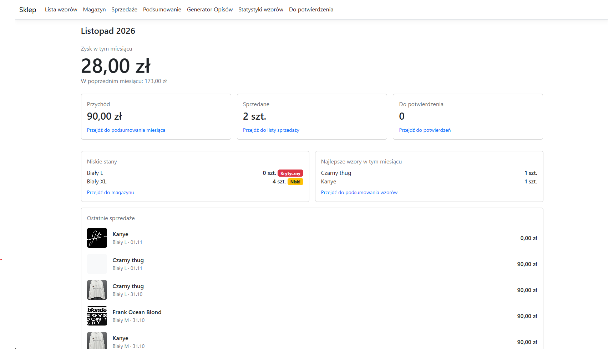
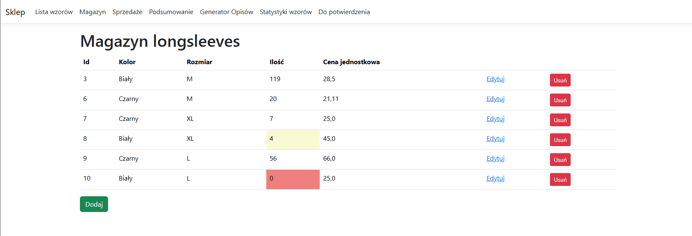
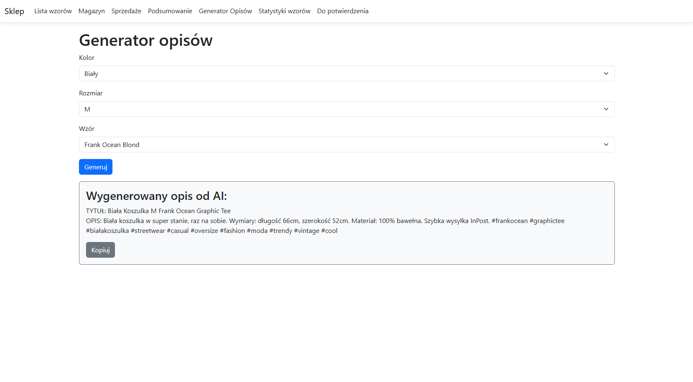

# DTF Shop Manager

A web app for running a small DTF-printed longsleeve business that sells on Vinted. It tracks the shop's Vinted profiles to catch likely sales, and keeps designs, stock, sales, profit and listing descriptions in one place. I built it from scratch to learn ASP.NET Core MVC. The interface is in Polish, as the shop operates in Poland.



## Features

- **Dashboard:** current and previous month's profit, low stock, top designs, recent sales
- **Designs:** library with images and print costs
- **Stock:** quantities by color and size, with low-stock warnings
- **Sales:** a register that updates stock automatically and keeps the costs from the time of sale
- **Statistics:** monthly income and profit, sales by design
- **Description generator:** listing descriptions written by OpenAI, kept different from the most recent ones
- **Vinted watcher:** tracks the shop's two Vinted profiles and turns listings that disappear into pre-filled sales, ready to confirm




## How the Vinted watcher works

1. Every 15 minutes, a background service fetches both public profile pages and reads each listing's title, price, size and photo.
2. New listings are saved, and OpenAI recognizes the longsleeve color and the design from the photo.
3. A listing that is no longer on the profile may have been sold, so it goes to a confirmation queue. If it comes back, it leaves the queue automatically.
4. In the queue, **Sold** opens a pre-filled sale form, and saving it records the sale and updates stock. **Reject** dismisses the listing.

## Tech stack

C#, ASP.NET Core MVC (.NET 10), Entity Framework Core, SQLite, Razor, Bootstrap, AngleSharp, OpenAI API

## Getting started

You need the .NET 10 SDK and the `dotnet-ef` tool.

```bash
cd Sklep_
dotnet ef database update
dotnet user-secrets set "OpenAI:ApiKey" "your-key"
dotnet user-secrets set "Vinted:Profile1Url" "profile-url"
dotnet user-secrets set "Vinted:Profile2Url" "profile-url"
dotnet user-secrets set "Descriptions:Prompt" "prompt-text"
dotnet run
```

The generator prompt is not part of this repository. It can use the placeholders `{Rozmiar}` (size), `{Kolor}` (color), `{Wzor}` (design) and `{PoprzednieOpisy}` (previous descriptions). Without profile URLs, the Vinted watcher skips those profiles.

## Limitations

The app has no login and is meant to run locally. The Vinted watcher reads the page's HTML, so it may stop working if the site changes.